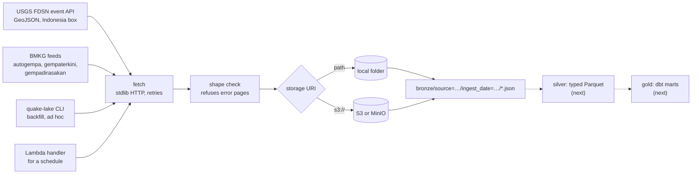

# quake-lake

A medallion-architecture data pipeline for Indonesian earthquake data: USGS and BMKG feeds land
raw in a bronze layer on S3 (or MinIO, or a local folder), to be modelled with dbt, orchestrated
with Airflow and deployed with Terraform. Everything runs locally against MinIO; DuckDB joins
with the gold layer.

[](https://github.com/Julminus/quake-lake/actions/workflows/ci.yml)

[](LICENSE)

**Status:** the bronze layer (ingestion) is built and measured. Silver (typed Parquet,
cross-source deduplication), gold (dbt), Airflow and Terraform come next; see
[What's next](#whats-next).


<sub>Real output, recorded by `scripts/render_screenshot.py` against the MinIO from `compose.yaml`.</sub>

## Results

Measured on 2026-11-20 on this PC (Windows 11, a home connection in Indonesia). Where each
number comes from, and how to re-run it, is in [`docs/results/`](docs/results/README.md).

- **Backfill, 2015-01-01 to 2026-11-20:** 143 requests (one per calendar month), **26,763
  events, 19.0 MB of raw GeoJSON, 139.2 s** to a local folder. One request takes 0.95 s at the
  median and 1.19 s at p95. Writing all 143 objects takes 0.09 s of that, so the time is the
  USGS requests. The same backfill into MinIO took 141.6 s, 1.2 s of it writing, and stored
  the same 18,990,379 bytes.
- **Asking for gzip cut the backfill from 182.8 s to 139.2 s.** USGS sends a month about 7
  times smaller. Fetching 12 months 3 times each way, interleaved so a slow spell on the
  network hits both: median request 1.03 s to 0.60 s, 4.7 MB to 0.7 MB on the wire.
- **One query per month is far from USGS's 20,000-event limit.** The busiest month since 2015 was
  August 2026, with 606 events. A single query for the whole range is refused with HTTP 400
  ("… matching events exceeds search limit of 20000"), and the CLI prints that reason.
- **No event appears in two windows.** USGS treats both ends of a time range as inclusive, so an
  event exactly on a month boundary could be fetched twice. 26,763 events, 26,763 unique ids. The
  silver layer deduplicates on id anyway.
- **What USGS has for this box:** M3.0 to M7.8 (median M4.4), and 99.7% of the events with a
  magnitude are M4.0+ (one has none), so this is the global catalogue's view, not a local
  network's. 2,725 events of M5.0+, 204 of M6.0+, 24 of M7.0+. All are `reviewed`; 26,762 are
  earthquakes and 1 is a volcanic eruption. Bronze keeps the eruption; filtering is the silver
  layer's call.
- **BMKG:** each snapshot of the three public feeds holds 31 events (the latest one, the latest
  15 of M5.0+, the latest 15 felt), about 9.3 KB.
- **The Lambda handler runs in AWS's Lambda runtime image.** In `public.ecr.aws/lambda/python:3.12`
  under its local emulator, with only `src/` mounted (what a zip deployment ships; boto3
  1.43.127 comes from the image), three cold starts: init 186 to 386 ms, and one live
  invocation each (all three BMKG feeds plus two days of USGS) 1.10 to 1.53 s. CI starts the
  same image on every push to `main` and every pull request, and invokes the handler with an
  event it must refuse, which needs no network.
- **MinIO:** with the image pulled, `docker compose up -d --wait minio` is healthy in 2.3 to
  2.4 s. The CLI's image is 233 MB.
- **Tests:** 103 offline tests (recorded responses; one concurrency test runs on Linux only) at
  100% branch coverage (CI fails below 90%), in 2.6 s. One more test does a storage round trip
  against a real MinIO; CI runs it too.

## How it works



Bronze layout, one `ingest_date` (UTC) per run:

```
bronze/
  source=usgs/ingest_date=2026-11-20/20150101T000000Z_20150201T000000Z.json   one object per window
  source=bmkg/ingest_date=2026-11-20/autogempa_20261120T182239Z.json         one per feed per poll
```

- **`quake-lake usgs`** fetches the last 7 days (`--days N`), or backfills month by month
  (`--since 2015-01-01 [--until ...]`). **`quake-lake bmkg`** snapshots the three feeds. Both
  print each object as it lands, so a failure part-way shows what reached bronze.
- **`quake_lake.handler.lambda_handler`** reads `BRONZE_URI` and an optional event
  `{"sources": ["usgs", "bmkg"], "days": 7}`. It polls BMKG's three feeds first, one at a time,
  then USGS. If one feed or source fails, the rest still write their snapshots, and then the
  invocation fails, so Lambda's retries and alarms see it.
- **Storage** is one URI: a folder, or `s3://bucket/prefix`. S3 goes through plain boto3, so
  MinIO is selected with the standard `AWS_ENDPOINT_URL_S3` variable, not a code path of its own.

## Quickstart

Needs [uv](https://docs.astral.sh/uv/) and GNU make; Docker for MinIO.

```bash
git clone https://github.com/Julminus/quake-lake && cd quake-lake
uv sync
uv run quake-lake bmkg                       # BMKG snapshot into lake/bronze
uv run quake-lake usgs --since 2026-01-01    # USGS backfill, one request per month
make test                                    # offline, recorded responses
```

`make backfill` fetches everything since 2015 into `lake/bronze` (about 2.5 minutes). The CLI
writes to `$BRONZE_URI` when it is set, else to `lake/bronze`; `--bronze` overrides both.

**With MinIO instead of a local folder:** `make minio` starts it on 127.0.0.1:9000 and creates
the `lake` bucket, then `make minio-run` runs the CLI in a container, writing to
`s3://lake/bronze`. The console is at http://127.0.0.1:9001 (user `quakelake`, password
`quakelake-local`, or your own from `.env`; see `.env.example`). To run the MinIO storage
test, set the MinIO variables from `.env.example` and `QUAKE_LAKE_MINIO=1`, then
`uv run pytest -m minio`.

## Design decisions and trade-offs

- **Bronze stores the bytes the source sent, unchanged.** It only checks that the answer has the
  shape of the real feed (a GeoJSON `FeatureCollection`, BMKG's `Infogempa.gempa`), so an HTML
  error page or a JSON error never lands as data. Parsing and typing wait for silver, so when the
  silver logic changes, it can be re-run over bronze without fetching anything again.
- **`ingest_date` is the UTC date.** A scheduled Lambda runs in UTC, and a run from a laptop in
  Jakarta must land in the same partition: the measured backfill ran at 01:58 WIB on 21
  November, which is still the 20th in UTC, so its objects are under `ingest_date=2026-11-20`.
  The library refuses a naive (zone-less) time rather than read it as the machine's local
  time; the CLI reads a `--since` or `--until` without a zone as UTC.
- **A look-back window instead of a watermark.** A scheduled USGS run (the schedule comes with
  the Terraform step) asks for the last 7 days every time. It needs no state, re-running it is harmless, and it picks up events USGS revises
  within a week. The limit: a revision older than the window is only picked up by a new
  backfill. USGS's `updatedafter` parameter with a stored watermark would close that gap.
- **BMKG must be polled often, and first.** Its feeds only hold the latest events: `autogempa`
  just one, and in the recorded snapshot the 15 felt events span about 2.5 days and the 15
  M5.0+ events 22 days. Events that scroll off between polls are gone. So the handler polls
  BMKG before USGS (a hung USGS can take 4 × 60 s timeouts plus back-off, 247 s, or 420 s if
  it answers 503 with `Retry-After: 60` each time), isolates every feed, and takes `sources`
  in the event: the plan is an hourly BMKG schedule next to a daily USGS one, with a Lambda
  timeout above that worst case.
- **Standard-library HTTP, boto3 as the only dependency.** The Lambda runtime already has boto3,
  so the deployment package is just `src/`. Retries cover network errors and HTTP 429, 500,
  502, 503 and 504, with exponential back-off (1, 2, 4 s), and honour a numeric `Retry-After`,
  capped at 60 s. Any other status fails at once with the server's reason. Responses are asked
  for gzipped and decoded in `fetch()`.
- **Sequential requests.** A full backfill is 143 requests and under 2.5 minutes, so
  concurrency would only add load on a free public service.
- **The backfill stops at the first failure; BMKG doesn't.** A backfill is cheap to re-run: on
  the same UTC day it overwrites the same keys, except the last, partial month, whose new
  object lands next to the old one (silver deduplicates). A stop is easy to see. A BMKG feed
  that isn't snapshotted now may be gone later, so `quake-lake bmkg` and the handler go on to
  the next feed and fail at the end.
- **Writes can't be half-seen.** A local write goes to a temp file unique to that call and is
  renamed over the key, so a reader sees the old object or the new one (tested with four
  concurrent writers on Linux). On Windows, a second writer or an open reader of the same key
  makes the rename fail instead; bronze keys carry a timestamp, so that needs two runs in the
  same second. S3 puts are atomic by design.
- **MinIO from Chainguard.** MinIO stopped publishing community images in 2025 (`minio/minio`
  is gone from Docker Hub), so `compose.yaml` uses Chainguard's build from source, pinned by
  digest. Its ports bind to 127.0.0.1 only.

## What's next

- **Silver:** typed records, deduplication across USGS and BMKG (event id plus a time and
  distance tolerance), idempotent partitioned Parquet, `pandera` validation with a quarantine
  path, and the nearest Indonesian province for each event.
- **Gold:** dbt-duckdb staging, intermediate and mart models with tests.
- **Airflow** (`docker compose up` for MinIO, Airflow and the pipeline), then **Terraform** for
  S3, Lambda with EventBridge schedules, Glue and Athena (plan only), then a **Streamlit**
  dashboard.

## Data and credits

Earthquake data from the [USGS Earthquake Hazards Program](https://earthquake.usgs.gov/fdsnws/event/1/)
(public domain) and from BMKG, Badan Meteorologi, Klimatologi, dan Geofisika
([data.bmkg.go.id](https://data.bmkg.go.id/gempabumi/)), which asks to be credited as the source.

## License

MIT, see [LICENSE](LICENSE).
