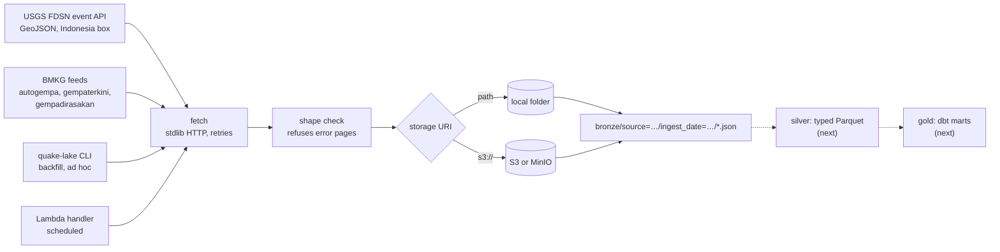

# quake-lake

A medallion-architecture data pipeline for Indonesian earthquake data: USGS and BMKG feeds land
raw in a bronze layer on S3 (or MinIO, or a local folder), to be modelled with dbt, orchestrated
with Airflow and deployed with Terraform. It runs fully local with MinIO and DuckDB.

[](https://github.com/Julminus/quake-lake/actions/workflows/ci.yml)

[](LICENSE)

**Status:** the bronze layer (ingestion) is built and measured. Silver (typed Parquet,
cross-source deduplication), gold (dbt), Airflow and Terraform come next; see
[What's next](#whats-next).


<sub>Real output, recorded by `scripts/render_screenshot.py` against the MinIO from `compose.yaml`.</sub>

## Results

All numbers are from this PC (Windows 11, home connection in Indonesia), measured on
2026-11-20. The raw record is [`docs/results/backfill-s7.json`](docs/results/backfill-s7.json),
written by `scripts/measure_backfill.py`.

- **Backfill, 2015-01-01 to 2026-11-20:** 143 requests (one per calendar month), **26,762 events,
  19.0 MB of raw GeoJSON, 182.8 s** to a local folder. One request takes 1.29 s at the median,
  1.50 s at p95. Writing all 143 objects to disk takes 0.04 s of that, so the time is the USGS
  requests.
- **One query per month is far from USGS's 20,000-event limit.** The busiest month since 2015 was
  August 2026, with 606 events. A single query for the whole range is refused with HTTP 400
  ("26761 matching events exceeds search limit of 20000"), and the CLI shows that reason.
- **No event appears in two windows.** USGS treats both ends of a time range as inclusive, so an
  event exactly on a month boundary could be fetched twice. 26,762 events, 26,762 unique ids. The
  silver layer deduplicates on id anyway.
- **What USGS has for this box:** M3.0 to M7.8 (median M4.4), 99.7% of it M4.0+, so this is
  the global catalogue's view, not a local network's. 2,725 events of M5.0+, 204 of M6.0+, 24 of
  M7.0+. All 26,762 are `reviewed`; 26,761 are earthquakes and 1 is a volcanic eruption. Bronze
  keeps the eruption; filtering is the silver layer's call.
- **BMKG:** each snapshot of the three public feeds holds 31 events (the latest one, the latest
  15 of M5.0+, the latest 15 felt), about 9.3 KB.
- **The Lambda handler runs in AWS's own runtime.** In the `public.ecr.aws/lambda/python:3.12`
  image, with only `src/` mounted (what a zip deployment ships; boto3 1.43.127 comes from the
  runtime), under the image's local emulator: init 362 ms, and one invocation (USGS for the
  last 2 days plus all three BMKG feeds, live) 1,138 ms. CI starts the same image on every push
  and invokes the handler with an event it must refuse, which needs no network.
- **MinIO:** with the image pulled, `docker compose up -d --wait minio` is healthy in 3 s. The
  CLI's image is 233 MB.
- **Tests:** 73 offline tests (recorded responses, no network) at 100% branch coverage, plus a
  storage round trip against a real MinIO that CI runs too.

## How it works



Bronze layout, one `ingest_date` (UTC) per run:

```
bronze/
  source=usgs/ingest_date=2026-11-20/20150101T000000Z_20150201T000000Z.json   one object per window
  source=bmkg/ingest_date=2026-11-20/autogempa_20261120T182239Z.json         one per feed per poll
```

- **`quake-lake usgs`** fetches the last 7 days (`--days N`), or backfills month by month
  (`--since 2015-01-01 [--until ...]`). **`quake-lake bmkg`** snapshots the three feeds. Both
  print each object as it lands, so a failure part-way shows what reached bronze.
- **`quake_lake.handler.lambda_handler`** reads `BRONZE_URI` and an optional event
  `{"sources": ["usgs", "bmkg"], "days": 7}`. If one source fails, the other still writes its
  snapshot, and then the invocation fails, so Lambda's retries and alarms see it.
- **Storage** is one URI: a folder, or `s3://bucket/prefix`. S3 goes through plain boto3, so
  MinIO is selected with the standard `AWS_ENDPOINT_URL_S3` variable, not a code path of its own.

## Quickstart

Needs [uv](https://docs.astral.sh/uv/); Docker for MinIO.

```bash
git clone https://github.com/Julminus/quake-lake && cd quake-lake
uv sync
uv run quake-lake bmkg                       # BMKG snapshot into lake/bronze
uv run quake-lake usgs --since 2026-01-01    # USGS backfill, one request per month
make test                                    # offline, recorded responses
```

With MinIO instead of a local folder: `make minio` (starts it on 127.0.0.1:9000 and creates the
`lake` bucket), then `make minio-run` (the CLI in a container, writing to `s3://lake/bronze`).
The console is at http://127.0.0.1:9001 (user `quakelake`, password `quakelake-local`, or your
own from `.env`; see `.env.example`). `make backfill` fetches everything since 2015 (about 3
minutes).

## Design decisions and trade-offs

- **Bronze stores the bytes the source sent, unchanged.** It only checks that the answer has the
  shape of the real feed (a GeoJSON `FeatureCollection`, BMKG's `Infogempa.gempa`), so an HTML
  error page or a JSON error never lands as data. Parsing and typing wait for silver, so when the
  silver logic changes, it can be re-run over bronze without fetching anything again.
- **`ingest_date` is the UTC date.** A scheduled Lambda runs in UTC, and a run from a laptop in
  Jakarta must land in the same partition: the measured backfill ran at 01:23 WIB on 21
  November, which is still the 20th in UTC, so its objects are under `ingest_date=2026-11-20`.
  A naive (zone-less) time is refused rather than read as the machine's local time.
- **A look-back window instead of a watermark.** The scheduled USGS run asks for the last 7 days
  every time. It needs no state, re-running it is harmless, and it picks up events USGS revises
  within a week. The limit: a revision older than the window is only picked up by a new
  backfill. USGS's `updatedafter` parameter with a stored watermark would close that gap.
- **BMKG must be polled often.** Its feeds only hold the latest events, so a missed poll is lost
  for good. That's why the handler isolates sources and takes `sources` in the event: the plan
  is an hourly BMKG schedule next to a daily USGS one.
- **Standard-library HTTP, boto3 as the only dependency.** The Lambda runtime already has boto3,
  so the deployment package is just `src/`. Retries cover network errors, 429 and 5xx with
  exponential backoff (1, 2, 4 s) and honour a numeric `Retry-After`, capped at 60 s. Any other
  4xx fails at once with the server's reason.
- **Sequential requests.** A full backfill is 143 requests and 3 minutes, so concurrency would
  only add load on a free public service.
- **The backfill stops at the first failure; the Lambda doesn't.** A backfill is cheap to
  re-run (on the same UTC day it overwrites the same keys, except the last, partial month), and
  a stop is easy to see. A scheduled run that stopped at USGS would lose BMKG's snapshot.
- **MinIO from Chainguard.** MinIO stopped publishing community images in 2025 (`minio/minio`
  is gone from Docker Hub), so `compose.yaml` uses Chainguard's build from source, pinned by
  digest. Its ports bind to 127.0.0.1 only.

## What's next

- **Silver:** typed records, deduplication across USGS and BMKG (event id plus a time and
  distance tolerance), idempotent partitioned Parquet, `pandera` validation with a quarantine
  path, and the nearest Indonesian province for each event.
- **Gold:** dbt-duckdb staging, intermediate and mart models with tests.
- **Airflow** (`docker compose up` for MinIO, Airflow and the pipeline), then **Terraform** for
  S3, Lambda with EventBridge schedules, Glue and Athena (plan only), then a **Streamlit**
  dashboard.

## Data and credits

Earthquake data from the [USGS Earthquake Hazards Program](https://earthquake.usgs.gov/fdsnws/event/1/)
(public domain) and from BMKG, Badan Meteorologi, Klimatologi, dan Geofisika
([data.bmkg.go.id](https://data.bmkg.go.id/gempabumi/)), which asks to be credited as the source.

## License

MIT, see [LICENSE](LICENSE).
