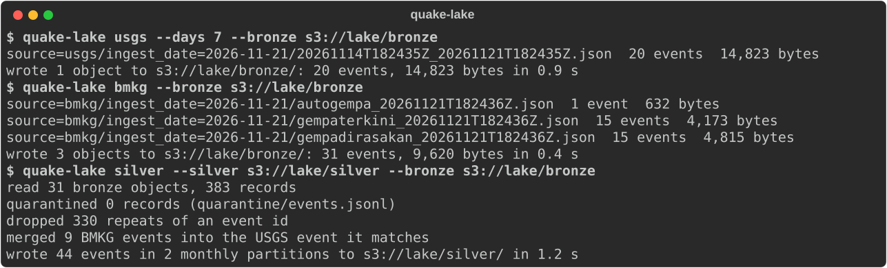
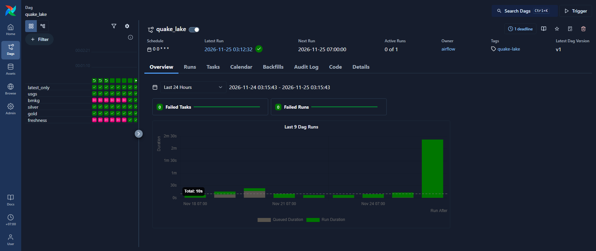
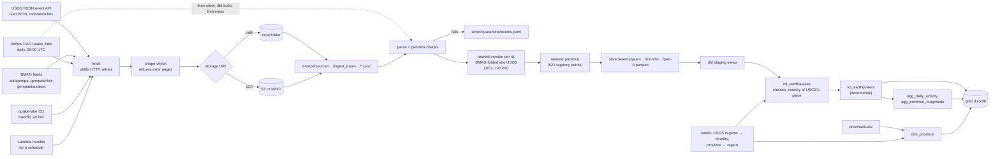
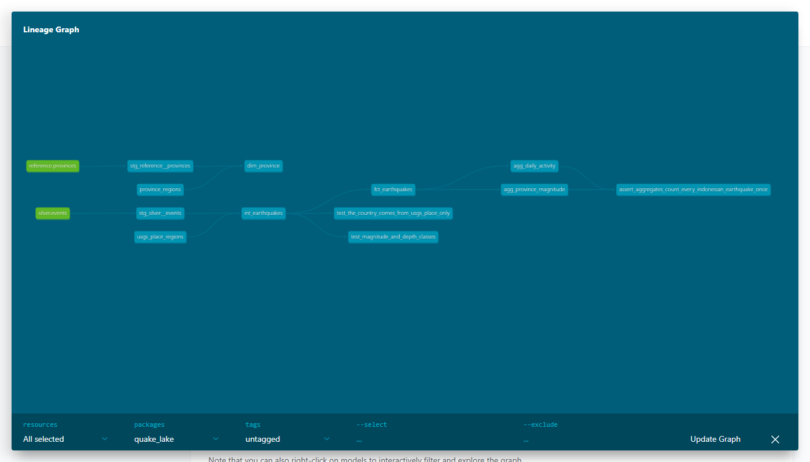
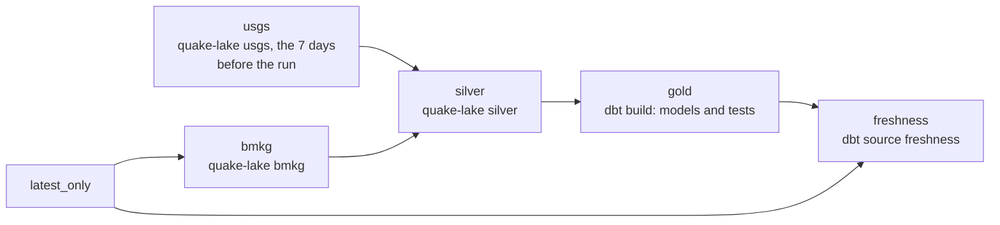

# quake-lake

A medallion-architecture data pipeline for Indonesian earthquake data: USGS and BMKG feeds land
raw in a bronze layer on S3 (or MinIO, or a local folder), become one typed, deduplicated
Parquet table in silver, and are modelled with dbt and DuckDB into gold marts, once a day, by
an Airflow DAG. A Terraform deployment comes next. Everything runs on a laptop: `docker
compose up` starts MinIO and Airflow and runs the pipeline; without Docker, bronze and silver
go to a folder and gold to a DuckDB file.

[](https://github.com/Julminus/quake-lake/actions/workflows/ci.yml)

[](LICENSE)

**Status:** bronze (ingestion), silver (typed Parquet, validation, deduplication across
sources, provinces), gold (dbt models, tests and an incremental fact table) and the Airflow
DAG that runs them daily are built and measured. Terraform comes next; see
[What's next](#whats-next).



<sub>Real output, recorded by `scripts/render_screenshot.py` against the MinIO from `compose.yaml`.</sub>

## Results

Measured on 2026-11-20 (bronze), 2026-11-21 (silver), 2026-11-22 (gold) and 2026-11-24
(Airflow, UTC) on this PC (Windows 11, Docker Desktop, a home connection in Indonesia).
Where each number comes from, and how to re-run it, is in
[`docs/results/`](docs/results/README.md).

### Airflow

From empty volumes, with the images built (`scripts/measure_airflow.py`):

- **`docker compose up -d --wait` takes 19.6 s**, and the DAG's four runs from 21 to 24
  November (three of them catch-up) were all done **61.1 s after it started**. A run takes
  7.0 to 9.9 s (in the first, `latest_only` and `usgs` took 2.0 to 2.6 s longer than in the
  others); `bmkg` and `freshness` were skipped in the three older runs and ran in the
  latest, as designed.
- **Airflow's own backfill** of the 3 days before the start date (`POST /api/v2/backfills`,
  what `airflow backfill create` does): three runs of 6.7 to 7.1 s, each fetching the 7 days
  before its date (11 to 18, 12 to 19 and 13 to 20 November, as Airflow rendered the
  command), with `bmkg` and `freshness` skipped.
- **A daily run over the whole history: 11.9 s.** With the local bronze (the S7 backfill
  and later fetches, 151 objects) copied into MinIO, the next run (BMKG and 7 days of USGS)
  rebuilt silver from all of bronze in 2.1 s and built and tested gold in 3.3 s. After the
  measurement, MinIO's bronze held 171 objects and 27,286 records: 26,799 events.
- **The gold Airflow built equals a local build, row for row.** Rebuilding silver and gold
  outside Docker from a copy of MinIO's bronze gives the same four marts (26,798
  earthquakes, 38 provinces, 4,345 days, 124 province and magnitude rows), with 0 rows in
  one and not the other. The Airflow fact table had been built incrementally over 9 runs,
  the local one in one go. This check caught a bug: a mean depth of exactly 27.35 came out
  27.3 in one build and 27.4 in the other, because a sum of floats depends on the row order,
  which differs between the two; gold now averages exact decimals.
- **Retries:** with MinIO stopped as a run started, `bmkg` and `usgs` both needed a second
  try. MinIO was started again once one of them was waiting for its retry, and after the
  2-minute retry delay both succeeded. The run succeeded in 141.5 s.
- **The deadline alert fires:** with the interval set to 1 s by hand for one run, the
  callback logged the miss 3 s after the deadline
  ([`deadline-s10.log`](docs/results/deadline-s10.log), 2026-11-23).
- **Memory:** 1,294 MiB with the stack idle (scheduler 741, API server 267, DAG
  processor 155, MinIO 71, Postgres 60); during the whole-history run the scheduler peaked
  at 1,199 MiB and MinIO at 253 (`docker stats`, sampled in a loop). Docker's VM here has
  9.7 GiB.
- **The Airflow image is 2.19 GB** (`docker images`; slim Airflow alone is 1.11 GB). It was
  3.18 GB before uv's download cache was kept out of it.



<sub>The Airflow UI after the measurement, captured with headless Chrome; times are WIB (UTC+7).</sub>

### Gold

Built with dbt from the silver below (26,782 events).

- **A full `dbt build` runs 7 models, 2 seeds, 41 data tests and 2 unit tests in about
  1 s** (0.92 to 0.98 s; 2.6 s when dbt has to parse the project from scratch; `make gold`,
  with dbt's start-up, 2.7 s on a repeat run and about 5 s on the first). All 52 pass.
- **20,638 of the 26,781 earthquakes count as Indonesian (77%).** USGS places the other
  6,143 in another country: 3,722 in the Philippines, 2,167 in Timor-Leste, 180 in Papua New
  Guinea, 48 in Palau, 23 in Malaysia, 2 near India's Nicobar Islands and 1 in Australia. The
  1,193 that USGS names only by a sea or region (1,017 "Banda Sea", 114 "Molucca Sea") and
  the 13 that only BMKG lists count as Indonesian. Sulawesi Utara keeps 2,056 of the 5,734
  events silver gave it.
- **The rule's limit, measured:** USGS names the nearest town on its own list, which can be
  far away. 287 events it places in the Philippines, 134 in Timor-Leste and 28 in Papua New
  Guinea are within 50 km of an Indonesian regency reference point, such as one "214 km S of
  Sarangani, Philippines" that is 10 km from a Sulawesi Utara point. Some of those are
  Indonesian; the ones near the Timor-Leste border may not be. Polygons of territory would
  settle it (see the design decisions).
- **Where they are:** Maluku 3,943, Maluku Utara 3,616, Sulawesi Utara 2,056, Nusa Tenggara
  Timur 1,596 and Papua 1,100 lead the 36 provinces with any; by region, Maluku has 7,559 and
  Kalimantan 42. 68% are shallow (under 70 km) and 708 are deep (300 km or more).
- **A median of 4 Indonesian earthquakes a day** (UTC) over the 4,343 days since 2015, and 87
  days with none. The busiest, 2 April 2026 (UTC), had 135: 132 of them in the northern
  Molucca Sea, which USGS places near Bitung or Ternate, in the hours after an M7.4 there
  at 22:48 UTC on 1 April (07:48 on the 2nd in Maluku Utara's time, WIT). UTC days put the
  M7.4 on the day before, and the nearest-province rule splits the 132 between Sulawesi
  Utara (69) and Maluku Utara (63).
- **The incremental fact table, on a real next fetch.** After a BMKG snapshot and a 7-day
  USGS look-back on 2026-11-22, `fct_earthquakes` rewrote **6 of its 26,786 rows** (5 new
  events, 1 that USGS had revised) and the result was **identical to a full refresh** (no
  event left silver in that fetch; the tests cover that case). At this size it saves
  nothing: both take about 0.1 s, because both read and hash all of silver.
- **Source freshness:** silver's newest event was 33.3 hours old (pass). dbt warns after 4
  days and errors after 7: the longest gap between two events since 2015 was 49.7 hours,
  and a daily fetch can add a day to that.

### Silver

Built from the local bronze: the full USGS backfill (143 objects), a 30-day USGS look-back
fetched a day later, and one BMKG snapshot. 147 objects, 26,913 records.

- **26,782 events in 143 monthly Parquet files, 3.1 MB** (the 147 JSON objects are 19.1 MB),
  rebuilt in 0.5 to 0.7 s (three runs; 1.0 to 1.2 s from the CLI, with imports). Rebuilding over the previous output gives **byte-identical files** (with
  the same library versions: the Parquet files record pandas' and pyarrow's).
- **116 repeats of an event dropped.** 113 USGS ids were in both the backfill and the
  look-back, and USGS had revised 5 of them in between (the newer version is kept); none had
  been renamed. BMKG's 31 records hold 28 events: the latest was in all three feeds, another
  in two.
- **15 BMKG events folded into the USGS event they match.** BMKG's 28 events split cleanly:
  the 15 matched (BMKG M5.1 to 7.2) were 0 to 5.0 s and 8 to 36 km from their USGS match
  (median 17 km), and each had only one USGS event within 300 s at any distance. The 13
  unmatched (BMKG M2.0 to M4.6) have no USGS event within 413 s; they're below the size USGS
  lists consistently here. **BMKG's magnitude was the same or higher for all 15**, by up to
  0.5 (median +0.3), so silver keeps USGS's values and links BMKG's id rather than mixing
  the two.
- **The merge tolerance, 10 s and 100 km, rarely fits two distinct events:** in 12 years of
  USGS data, 6 pairs of different events were that close.
- **0 of 26,913 real records failed validation.** The tests cover 29 kinds of bad record and
  8 kinds of unreadable object; each lands in `quarantine/events.jsonl` with its raw record.
- **Provinces: the nearest-reference-point rule agrees with province polygons for 93.5% of
  events** (OCHA's 34-province boundaries, compared at that level): 98.1% of the 4,117 on
  land and 92.7% of the 22,665 at sea. It does worst at sea 100 to 200 km from the nearest
  reference point (87.5%); beyond 200 km it agrees 96.6%.
- **The USGS box is not Indonesia.** For 22.9% of the USGS events, USGS's nearest town is in
  another country (3,712 in the Philippines, 2,160 in Timor-Leste, 180 in Papua New Guinea,
  43 in Palau). Silver still gives each its nearest Indonesian province, with `province_km`,
  so gold can decide what counts: 3,666 of Sulawesi Utara's 5,734 events have a USGS place
  in the Philippines.

### Bronze

- **Backfill, 2015-01-01 to 2026-11-20:** 143 requests (one per calendar month), **26,763
  events, 19.0 MB of raw GeoJSON, 139.2 s** to a local folder. One request takes 0.95 s at the
  median and 1.19 s at p95. Writing all 143 objects takes 0.09 s of that, so the time is the
  USGS requests. The same backfill into MinIO took 141.6 s, 1.2 s of it writing, and stored
  the same 18,990,379 bytes.
- **Asking for gzip cut the backfill from 182.8 s to 139.2 s.** USGS sends a month about 7
  times smaller. Fetching 12 months 3 times each way, interleaved so a slow spell on the
  network hits both: median request 1.03 s to 0.60 s, 4.7 MB to 0.7 MB on the wire.
- **One query per month is far from USGS's 20,000-event limit.** The busiest month since 2015 was
  August 2026, with 606 events. A single query for the whole range is refused with HTTP 400
  ("… matching events exceeds search limit of 20000"), and the CLI prints that reason.
- **No event appears in two windows.** USGS treats both ends of a time range as inclusive, so an
  event exactly on a month boundary could be fetched twice. 26,763 events, 26,763 unique ids. The
  silver layer deduplicates on id anyway.
- **What USGS has for this box:** M3.0 to M7.8 (median M4.4), and 99.7% of the events with a
  magnitude are M4.0+ (one has none), so this is the global catalogue's view, not a local
  network's. 2,725 events of M5.0+, 204 of M6.0+, 24 of M7.0+. All are `reviewed`; 26,762 are
  earthquakes and 1 is a volcanic eruption. Bronze and silver keep the eruption; filtering is
  gold's call.
- **BMKG:** each snapshot of the three public feeds holds 31 events (the latest one, the latest
  15 of M5.0+, the latest 15 felt), about 9.3 KB.
- **The Lambda handler runs in AWS's Lambda runtime image.** In `public.ecr.aws/lambda/python:3.12`
  under its local emulator, with only `src/` mounted (what a zip deployment ships; boto3
  1.43.127 comes from the image), three cold starts: init 186 to 386 ms, and one live
  invocation each (all three BMKG feeds plus two days of USGS) 1.10 to 1.53 s. CI starts the
  same image on every push to `main` and every pull request, and invokes the handler with an
  event it must refuse, which needs no network.
- **MinIO:** with the image pulled, `docker compose up -d --wait minio` is healthy in 2.3 to
  2.4 s. The CLI's image is 1,183 MB since gold (233 MB with bronze only, 688 MB with
  silver): pyarrow alone is 170 MB, and dbt brings DuckDB (66 MB), Babel (33 MB) and more.
- **Tests:** 199 offline tests (recorded responses and small built records; one concurrency
  test runs on Linux only) at 100% branch coverage of the Python package (CI fails below
  90%), in 14.5 to 15.1 s (three runs); 5 of them run dbt (about 10 s of that). 11 test the
  Airflow DAG and need Airflow, so they skip outside its image and CI runs them inside it.
  Two more run against a real MinIO (a storage round trip and a silver rebuild); CI runs
  them too.

## How it works



Bronze layout, one `ingest_date` (UTC) per run:

```
bronze/
  source=usgs/ingest_date=2026-11-20/20150101T000000Z_20150201T000000Z.json   one object per window
  source=bmkg/ingest_date=2026-11-20/autogempa_20261120T182239Z.json         one per feed per poll
```

- **`quake-lake usgs`** fetches the last 7 days (`--days N`), or backfills month by month
  (`--since 2015-01-01 [--until ...]`). **`quake-lake bmkg`** snapshots the three feeds. Both
  print each object as it lands, so a failure part-way shows what reached bronze.
- **`quake_lake.handler.lambda_handler`** reads `BRONZE_URI` and an optional event
  `{"sources": ["usgs", "bmkg"], "days": 7}`. It polls BMKG's three feeds first, one at a time,
  then USGS. If one feed or source fails, the rest still write their snapshots, and then the
  invocation fails, so Lambda's retries and alarms see it.
- **Storage** is one URI: a folder, or `s3://bucket/prefix`. S3 goes through plain boto3, so
  MinIO is selected with the standard `AWS_ENDPOINT_URL_S3` variable, not a code path of its own.
- **`quake-lake silver`** rebuilds silver (`$SILVER_URI`, else `lake/silver`) from every
  bronze object:

```
silver/
  events/year=2026/month=11/part-0.parquet   one file per month of origin time (UTC)
  quarantine/events.jsonl                    each failed record: bronze key, reasons, raw record
```

| Column | Type | Notes |
|---|---|---|
| `event_id` | string | USGS's id, or `bmkg-<UTC origin time>` (BMKG gives no id) |
| `source` | string | `usgs` or `bmkg`: where this row's values come from |
| `time`, `updated` | timestamp (ms, UTC) | origin time; `updated` is USGS's last revision (empty for BMKG) |
| `latitude`, `longitude`, `depth_km` | double | |
| `magnitude`, `mag_type` | double, string | `mag_type` is USGS's (`mb`, `mww`, ...); BMKG doesn't say |
| `place`, `event_type` | string | USGS's `place` or BMKG's `Wilayah`; `earthquake`, `volcanic eruption`, ... |
| `bmkg_id` | string | the BMKG event this row is, or was merged with; empty if BMKG never listed it |
| `province_code`, `province`, `province_km` | string, string, double | ISO 3166-2 code and name of the province of the nearest regency reference point, and the distance to that point |
| `bronze_key` | string | the bronze object the row came from |

- **`make gold`** (`dbt build` on the project in [`transform/`](transform/)) reads silver in
  place and builds gold into a DuckDB file, `$GOLD_DB`, else `lake/gold.duckdb`:

| Model | Kind | One row per |
|---|---|---|
| `stg_silver__events`, `stg_reference__provinces` | view | silver event; regency reference point (`provinces.csv`, read in place) |
| `int_earthquakes` | view | earthquake (other event types dropped), with magnitude and depth classes and the country of USGS's place |
| `fct_earthquakes` | incremental table | earthquake in the USGS box, with `in_indonesia` |
| `dim_province` | table | province (38), with its region, its number of reference points and their mean location |
| `agg_daily_activity` | table | UTC day from the first to the last, Indonesian earthquakes only (count, M5+, M6+, shallow, largest magnitude) |
| `agg_province_magnitude` | table | province and magnitude class, Indonesian earthquakes only |

Two seeds: `usgs_place_regions.csv` (which country each region in USGS's `place` belongs
to) and `province_regions.csv` (ISO 3166-2's seven regions). The tests: `unique`,
`not_null`, `accepted_values` and `relationships`, a small `accepted_range` test of the
project's own, a check that both aggregates count each Indonesian earthquake once, and two
unit tests of the classification. `make freshness` (`dbt source freshness`, not part of the
build) checks silver's newest event; `make docs` writes dbt's docs site to `transform/target/static_index.html`, which
draws the lineage:



<sub>dbt's generated docs (`make docs`), lineage view, captured with headless Chrome.</sub>

- **`docker compose up -d --wait`** (or `make airflow`) starts MinIO, Postgres and Airflow
  3.3 (LocalExecutor: an API server, a scheduler that runs the tasks, a DAG processor). The
  DAG in [`dags/quake_lake_daily.py`](dags/quake_lake_daily.py) is unpaused and runs at
  00:00 UTC every day, catching up one run per day from `QUAKE_LAKE_START_DATE`. Its tasks
  are the steps of `make run`, then `make freshness`, on MinIO:



  In a catch-up or backfill run, `latest_only` skips `bmkg` (BMKG's feeds only hold the latest events)
  and `freshness` (which compares with now); `silver` runs when `bmkg` was skipped, not when
  it failed. Every task retries twice, two minutes apart, and stops after 30 minutes; a run
  that hasn't succeeded an hour after it was queued calls a deadline alert. The UI is at
  http://127.0.0.1:8080 (no login, local only).

## Quickstart

Needs [uv](https://docs.astral.sh/uv/) and GNU make; Docker for MinIO.

```bash
git clone https://github.com/Julminus/quake-lake && cd quake-lake
uv sync
uv run quake-lake bmkg && uv run quake-lake usgs --since 2026-01-01   # into lake/bronze
uv run quake-lake silver                     # typed Parquet in lake/silver
make gold                                    # dbt build: lake/gold.duckdb, tests included
```

Then ask gold something, for instance the provinces with the most M5+ earthquakes:

```bash
uv run python -c "import duckdb; print(duckdb.connect('lake/gold.duckdb').sql('select province, count(*) as m5_plus from fct_earthquakes join dim_province using (province_code) where in_indonesia and magnitude >= 5 group by 1 order by 2 desc limit 5'))"
```

**The whole pipeline on Airflow**, with Docker only (the first `up` pulls the images it
needs, slim Airflow, Postgres, MinIO and its client, and uv, and builds the Airflow image):

```bash
git clone https://github.com/Julminus/quake-lake && cd quake-lake
docker compose up -d --wait                 # MinIO + Airflow: the DAG starts catching up
docker compose run --rm airflow-cli dags list-runs quake_lake
```

Each day since `QUAKE_LAKE_START_DATE` (default 2026-11-20; set a recent date in `.env`) is
one run of about 10 s. Then watch it at http://127.0.0.1:8080; `docker compose down` stops
it, and `docker compose down -v` also deletes MinIO's data, Airflow's database and gold.

`make test` runs the offline tests (recorded responses, no network).

`make backfill` fetches everything since 2015 into `lake/bronze` (about 2.5 minutes), and
`make silver` rebuilds silver from it. The CLI writes bronze to `$BRONZE_URI` when it is set,
else to `lake/bronze`, and silver to `$SILVER_URI`, else `lake/silver`; `--bronze` and
`--silver` override them. `make run` does a BMKG snapshot, the last 7 days of USGS, silver
and gold. Run dbt from the repository root (the Makefile does): the default paths are
relative to it, and the folder `$GOLD_DB` goes in must exist.

**With MinIO instead of a local folder:** `make minio` starts it on 127.0.0.1:9000 and creates
the `lake` bucket, then `make minio-run` runs the BMKG, USGS and silver steps (gold on MinIO runs in the Airflow stack) in a container, writing to
`s3://lake/bronze` and `s3://lake/silver`. The console is at http://127.0.0.1:9001 (user `quakelake`, password
`quakelake-local`, or your own from `.env`; see `.env.example`). To run the MinIO storage
tests, set the MinIO variables from `.env.example` and `QUAKE_LAKE_MINIO=1`, then
`uv run pytest -m minio`.

## Design decisions and trade-offs

- **Bronze stores the bytes the source sent, unchanged.** It only checks that the answer has the
  shape of the real feed (a GeoJSON `FeatureCollection`, BMKG's `Infogempa.gempa`), so an HTML
  error page or a JSON error never lands as data. Parsing and typing wait for silver, so when the
  silver logic changes, it can be re-run over bronze without fetching anything again.
- **`ingest_date` is the UTC date.** A scheduled Lambda runs in UTC, and a run from a laptop in
  Jakarta must land in the same partition: the measured backfill ran at 01:58 WIB on 21
  November, which is still the 20th in UTC, so its objects are under `ingest_date=2026-11-20`.
  The library refuses a naive (zone-less) time rather than read it as the machine's local
  time; the CLI reads a `--since` or `--until` without a zone as UTC.
- **A look-back window instead of a watermark.** The Airflow DAG's USGS task asks for the 7
  days before the run, every run (the Lambda handler's default is the same 7 days). It needs no state, re-running it is harmless, and it picks up events USGS revises
  within a week. The limit: a revision older than the window is only picked up by a new
  backfill. USGS's `updatedafter` parameter with a stored watermark would close that gap.
- **BMKG must be polled often, and first.** Its feeds only hold the latest events: `autogempa`
  just one, and in the recorded snapshot the 15 felt events span about 2.5 days and the 15
  M5.0+ events 22 days. Events that scroll off between polls are gone. So the handler polls
  BMKG before USGS, isolates every feed, and takes `sources` in the event: the plan is an
  hourly BMKG schedule next to a daily USGS one, with the Terraform step. The Airflow DAG
  polls BMKG once a day, which sees every felt event only while no more than 15 happen in a
  day (the recorded 15 spanned 2.5 days; an aftershock swarm can exceed it). A slow USGS can't be bounded by `fetch()`
  alone: its 60 s timeout applies to each wait on the socket, not to the request, so a server
  that answers slowly and then stalls can hold a run for many minutes (a stalled 503 with
  `Retry-After: 60` on all four attempts: 4 × (60 + 60) s plus 3 × 60 s, 11 minutes), and
  one that drips bytes has no limit. The Lambda timeout is the real cap, which is why
  nothing perishable runs after USGS.
- **Standard-library HTTP, boto3 as the only dependency.** The Lambda runtime already has boto3,
  so the deployment package is just `src/`. Retries cover network errors and HTTP 429, 500,
  502, 503 and 504, with exponential back-off (1, 2, 4 s), and honour a numeric `Retry-After`,
  capped at 60 s. Any other status fails at once with the server's reason. Responses are asked
  for gzipped and decoded in `fetch()`.
- **Sequential requests.** A full backfill is 143 requests and under 2.5 minutes, so
  concurrency would only add load on a free public service.
- **The backfill stops at the first failure; BMKG doesn't.** A backfill is cheap to re-run: on
  the same UTC day it overwrites the same keys, except the last, partial month, whose new
  object lands next to the old one (silver deduplicates). A stop is easy to see. A BMKG feed
  that isn't snapshotted now may be gone later, so `quake-lake bmkg` and the handler go on to
  the next feed and fail at the end.
- **Writes can't be half-seen.** A local write goes to a temp file unique to that call and is
  renamed over the key, so a reader sees the old object or the new one (tested with four
  concurrent writers on Linux). On Windows, a second writer or an open reader of the same key
  makes the rename fail instead; bronze keys carry a timestamp, so that needs two runs in the
  same second. S3 puts are atomic by design.
- **Silver is rebuilt from all of bronze on every run.** That makes it idempotent by
  construction: the same bronze gives the same bytes, an event USGS revises replaces its older
  version, and a BMKG event that USGS only lists a day later is merged on the next run, with
  no state to keep. A bronze without one valid record is refused rather than rebuilt from:
  a mistyped URI, or a folder of error pages, would otherwise delete every partition. A
  bronze that has lost most of its objects is not caught: silver mirrors whatever bronze
  holds. A month a rebuild leaves empty is deleted, so an event whose origin time
  moves across a month boundary isn't left in two files. The cost is reading every bronze
  object each time: 147 objects take under a second locally, but an hourly BMKG schedule adds
  about 26,000 small objects a year, which on S3 means as many GET requests per run. Reading
  only new `ingest_date` partitions and merging them into silver is the upgrade, once that
  starts to matter. A reader during a rebuild can see some months old and some new.
- **Validate first, then deduplicate.** Every row is checked before duplicates are resolved,
  so a broken revision (a magnitude of 99, say) goes to quarantine and the last good version
  stays in silver. Checks: coordinates inside the box USGS is queried with (BMKG covers a
  wider area; its events outside the box are quarantined, so both sources cover the same
  area), depth from -10 to 800 km, magnitude from -2 to 10 or missing, required fields
  present, numbers that are finite, and an origin time from 1900 to an hour after the fetch (the fetch time is in
  the bronze key, so the check gives the same answer on every rebuild; a WIB time read as
  UTC would be 7 hours late). Quarantine keeps the raw record, so a rule that was too strict
  can be fixed and the record recovered by the next rebuild, with nothing fetched again.
- **USGS's row wins a cross-source match, and `bmkg_id` keeps the link.** USGS's events are
  reviewed and carry stable ids; BMKG's feeds have no ids and its magnitudes run higher on
  the same events (above). Merging is one to one and closest in time first, so in an
  aftershock swarm two BMKG events can't both claim one USGS event (being greedy, it can
  leave a pair unmerged that a global assignment would match, in a three-way near tie). Time
  is the tolerance that tells events apart: within 10 s, distinct USGS events 50, 100 or
  150 km apart number 6 pairs each, against 20 at any distance.
- **USGS ids can change; BMKG's are made up.** USGS sometimes gives an event a new preferred
  id and lists the old one in `ids`, so a row is dropped when a newer row lists its id. BMKG
  has no ids, so silver names a BMKG event by its origin time: a revised time would make a
  second event. That hasn't happened yet: the 25 events in both the recorded snapshot
  (2026-11-20) and the next day's had the same times, places and magnitudes.
- **Provinces from 522 reference points, not polygons.** The bundled table
  (`src/quake_lake/provinces.csv`, 25 KB) has one centre point per regency, city and large
  lake, with its province, from OCHA's Indonesia boundaries; `scripts/build_provinces.py`
  rebuilds it and applies the 2022 split of Papua into six provinces, which OCHA's 2020 data
  predates. Nearest point is a numpy dot product with no geometry dependency, and it agrees
  with polygons for 93.5% of events. It is wrong mostly at sea, 50 to 200 km from a
  reference point, where the nearest province is arguable anyway; point-in-polygon with
  bundled, simplified boundaries is the upgrade if a province leaderboard needs those few
  percent.
- **Every event type stays in silver.** USGS lists one volcanic eruption among the 26,769;
  silver keeps it as `event_type = volcanic eruption`, and gold's `int_earthquakes` drops it.
- **The country list is a seed, not code.** The box USGS is queried with reaches the
  Philippines, Timor-Leste and Papua New Guinea, so gold reads the country from USGS's own
  `place` ("... of Sarangani, Philippines", or a region such as "Banda Sea") and looks it up
  in `transform/seeds/usgs_place_regions.csv`. An event is Indonesian unless that country is
  another one. To change which regions count, edit the CSV and rebuild. Limits: it is the
  country of the nearest town on USGS's list, not of the water or land the event is in, so
  an event 10 km from Sangihe's reference point can be "214 km S of Sarangani,
  Philippines" (449 foreign-placed events are within 50 km of an Indonesian reference
  point, above); a sea or region with no single country counts as Indonesian; BMKG-only
  events have no USGS place and count too (all 13 so far name an Indonesian town, and every
  BMKG event of M5 or more matched a USGS event, whose place then decides). A region the
  seed doesn't know yet counts as Indonesian, and a `relationships` test warns about it on
  every build; a country code the YAML doesn't list warns too, without failing the build (a
  typo such as `id` would make the 19,430 events USGS places in Indonesia foreign). A
  distance rule ("within 50 km of a reference point is Indonesian") would fix Sangihe and
  break the Timor-Leste border, so the upgrade is territory polygons, not another
  threshold.
- **The fact keeps every earthquake; the aggregates count the Indonesian ones.**
  `fct_earthquakes` has all 26,781 earthquakes in the box with `in_indonesia`, so a question
  about the whole region still has the data, while the daily and province marts answer for
  Indonesia only.
- **Incremental by row hash.** Silver is rebuilt in full every run, so there is no
  "loaded since" column to filter on, and events also leave silver (a BMKG event merged into
  USGS a day later, an id USGS replaced). `fct_earthquakes` hashes every row
  (`md5(to_json(row))`), rewrites only the rows whose hash is new (`delete+insert` on
  `event_id`), and a post-hook deletes the ids silver no longer has. Like silver's refusal of
  an empty bronze, that delete does nothing when `int_earthquakes` is empty, so `dbt run
  --empty` (which leaves the views empty) can't wipe the table; the limit is that the last
  earthquakes can't leave (if silver had no earthquakes left, the fact would keep its old
  ones, while a full refresh would be empty). The tests check that an incremental run equals a
  full refresh after a revision, a rename, a merge, a new event, a USGS change that leaves
  `updated` alone and a revised BMKG-only event (which has no `updated`), and that `--empty`
  and the run after it leave the table alone; so did a real fetch (above, with no event
  leaving silver). At 27,000 rows it saves no time, since it still reads all of silver; it
  pays once silver is read incrementally too and the fact is large, or when each write costs
  money.
- **The province table is read in place.** `stg_reference__provinces` reads
  `src/quake_lake/provinces.csv`, the file silver uses, as a dbt source, so the two can't
  drift apart; the regions come from a separate seed, and a `not_null` test on
  `dim_province.region` catches a province missing from it.
- **Days are UTC days.** Indonesia spans three time zones (WIB, WITA, WIT), so a "local day"
  would depend on the province; `agg_daily_activity` counts UTC days, as its description
  says, and the fact's columns end in `_utc`.
- **No dbt packages, no telemetry.** The one test dbt doesn't ship, `accepted_range`, is a
  few lines in `transform/tests/generic/`, so there is no `dbt deps` step that needs the
  network; dbt's anonymous usage statistics are off in `dbt_project.yml`. dbt Core 1.12 is
  used because dbt-duckdb is a Core adapter (`dbt --version` notes that v2 exists).
- **pandas, pyarrow and pandera only where they're needed.** The CLI imports them only for
  `silver`, so the ingest commands start as fast as before, and the Lambda handler never
  imports them; its bundle is still just `src/` on the runtime's boto3. The CLI image
  carries them all, and dbt too (1,183 MB); the Airflow image builds the same virtualenv
  against its own Python, with `transform/` next to it.
- **Airflow runs the CLI, from a virtualenv of its own.** Every task but `latest_only` is a
  `BashOperator` calling `/app/.venv/bin/quake-lake` or `/app/.venv/bin/dbt`, the commands
  `make run` and `make freshness` use, so a task fails when its command exits non-zero
  (`quake-lake` with a one-line `error:`, dbt with its summary) and can be re-run by hand
  the same way. The pipeline's virtualenv is built against the Airflow
  image's Python from `uv.lock`, so Airflow's pinned dependencies and dbt's never have to
  agree; Airflow itself is the slim image (core and the five providers it requires,
  `standard` among them) plus its two Postgres drivers, at the versions Airflow's
  constraints pin. The cost is the image: 2.19 GB as `docker images` reports it, against
  1.11 GB for slim Airflow alone. It was 3.18 GB until uv's download cache (987 MB) was
  kept out of it with a build cache mount: the Airflow base image puts `UV_CACHE_DIR` in
  `/tmp`, inside the layer.
- **Catch-up fills missed days, a backfill any past ones; the 12-year history is one
  fetch.** `catchup=True` makes a run for every day since the last scheduled run, or since
  the start date on the first `up` (the PC was off, Airflow was down; a gap before the last
  run isn't refilled), and since each run fetches the 7 days before its date, a USGS gap
  of any length closes run by run (BMKG events that scrolled off its feeds meanwhile are
  gone). Airflow's own backfill (`docker compose run --rm airflow-cli backfill create
  --dag-id quake_lake --from-date ... --to-date ...`) runs any past days the same way,
  measured above; so does a run triggered for a past date (its logical date, not the
  trigger time, ends the window), unless it's before the start date: Airflow then creates
  no tasks and marks the empty run a success. Neither is how to
  load 2015 to today: about 4,350 daily runs would each rebuild silver from all of bronze,
  so the history is `quake-lake usgs --since 2015-01-01` (143 monthly requests,
  2.5 minutes; `docker compose run --rm ingest usgs --since 2015-01-01` on MinIO), and the
  next run builds on it. The start date is `QUAKE_LAKE_START_DATE` (a date, read as 00:00
  UTC), else 2026-11-20: a fixed default, so the later someone starts the stack without
  setting it, the more catch-up runs there are (one per day, about 10 s each).
- **One run at a time.** Silver is rebuilt from all of bronze and gold is one DuckDB file,
  so two runs at once would race; `max_active_runs=1` queues them.
- **The data-quality checks are dbt's, in two places.** `dbt build` runs the 41 data tests
  between the models, so a failing test stops the marts downstream of it from being
  replaced (a `dbt run` followed by `dbt test` would publish first and check after); then
  `dbt source freshness` fails the latest run when silver's newest event is 7 days old.
  Silver's own checks (pandera, quarantine) run inside the silver task. Quarantined records
  don't fail a run: they are kept and counted, not lost.
- **Retries, timeouts and a deadline instead of an SLA.** Each task retries twice, 2 minutes
  apart (a BMKG or USGS outage, MinIO restarting), on top of `fetch()`'s own retries, and
  stops after 30 minutes (a stalled USGS request can take 11, above). Airflow 3 removed
  SLAs; their replacement is a deadline alert, still marked experimental: a run that hasn't
  succeeded an hour after it was queued calls `missed_deadline` in
  [`plugins/quake_lake_alerts.py`](plugins/quake_lake_alerts.py), which logs an error in
  the scheduler's log. That is where a Slack or email notifier would go; none is set up.
  Airflow clears a run's deadline only when the run succeeds, so a run that failed early
  is still reported when its hour is up: its data isn't there either.
  The callback lives in a plugin module because Airflow stores it as an import path and a
  DAG file can't be imported by name.
- **LocalExecutor, no Celery.** The scheduler runs the tasks as its own subprocesses, so
  there is no Redis and no worker container; a run takes about 10 s of work a day. The
  official compose file adds Redis and a Celery worker (and Flower, behind a profile) for
  capacity this pipeline doesn't need, and a triggerer, which no task here uses. The task
  processes call the API server, so the scheduler waits for it to be healthy (a task
  started before it fails and spends a retry); Postgres and MinIO restart with Airflow's
  services (`restart: unless-stopped`) after a crash or a Docker restart, since without
  them the scheduler only restart-loops and no run, and no deadline alert, happens.
- **Gold reads silver from MinIO; gold itself stays a file.** dbt's `minio` target
  (`DBT_TARGET=minio`, set in `compose.yaml`) loads DuckDB's httpfs extension, installed
  into the image at build time, and passes the CLI's MinIO variables as a DuckDB S3
  secret, so the same models read `s3://lake/silver/...` in place. `gold.duckdb` lives on
  a Docker volume next to the scheduler, since DuckDB writes a local file; S3 and Athena
  would want the marts as Parquet, which is later work.
- **No login, 127.0.0.1 only.** The UI and API run with Airflow's simple auth manager in
  "everyone is an admin" mode, and like MinIO's ports they bind to the loopback address.
  The Postgres password and the API token secret are local defaults (the secret can be set
  with `AIRFLOW_JWT_SECRET` in `.env`). Loopback keeps other machines out, not a web page
  in your own browser (DNS rebinding), and the API can trigger runs and read logs. None
  of this is a deployment.
- **CI runs the DAG's tasks in the Airflow image on a recorded day.** The `airflow` job runs
  the DAG tests in the image (with `QUAKE_LAKE_AIRFLOW=1`, so a broken Airflow fails them
  rather than skipping them), loads httpfs in a container with no network, then runs
  `silver`, `gold` and `freshness` with `airflow tasks test` on the Palu fixture in MinIO
  (nothing fetched): silver must write the fixture's 81 events to S3, gold must read them
  back through httpfs and pass dbt's tests, and freshness must fail, since the day is from
  2018. The `usgs` and `bmkg` tasks need the network and aren't run in CI; the test of the
  USGS command renders its template. `airflow dags test` would run the whole DAG, but in
  Airflow 3.3.2 it ends in a traceback and a non-zero exit once a DAG with a deadline
  alert succeeds
  ([apache/airflow#73428](https://github.com/apache/airflow/issues/73428)).
- **MinIO from Chainguard.** MinIO stopped publishing community images in 2025 (`minio/minio`
  is gone from Docker Hub), so `compose.yaml` uses Chainguard's build from source, pinned by
  digest. Its ports bind to 127.0.0.1 only.

## What's next

- **Terraform** for S3, Lambda with EventBridge schedules (hourly BMKG, daily USGS), Glue
  and Athena (plan only), then a **Streamlit** dashboard on the gold marts.
- **Airflow, later:** a Slack or email notifier on the deadline alert and on failures; a
  whole-DAG test with `airflow dags test` once apache/airflow#73428 is fixed (its manual run
  would fetch BMKG and USGS live, so CI would need them pointed at recorded responses).
- **Gold, later:** local days per province (WIB, WITA, WIT); the marts as Parquet for Athena.
- **Silver, later:** read only new bronze partitions once a full rebuild gets slow on S3;
  province polygons.

## Data and credits

Earthquake data from the [USGS Earthquake Hazards Program](https://earthquake.usgs.gov/fdsnws/event/1/)
(public domain) and from BMKG, Badan Meteorologi, Klimatologi, dan Geofisika
([data.bmkg.go.id](https://data.bmkg.go.id/gempabumi/)), which asks to be credited as the source.

The province reference points are derived from OCHA's
[Indonesia administrative boundaries](https://data.humdata.org/dataset/cod-ab-idn) (COD-AB,
from BPS and BIG), licensed [CC BY-IGO 3.0](https://creativecommons.org/licenses/by/3.0/igo/);
the 2022 Papua provinces were checked against [Wikidata](https://www.wikidata.org/) (CC0). The
polygons used only to measure the province step are OCHA's too, from
[geoBoundaries](https://www.geoboundaries.org/) (gbHumanitarian, IDN ADM1).

## License

MIT, see [LICENSE](LICENSE).
