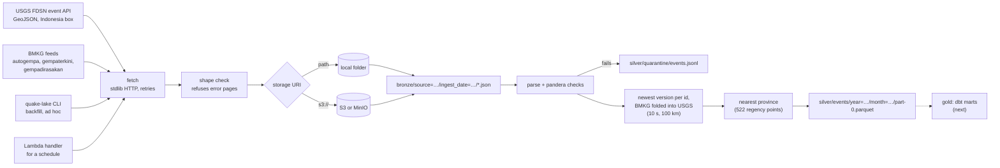

# quake-lake

A medallion-architecture data pipeline for Indonesian earthquake data: USGS and BMKG feeds land
raw in a bronze layer on S3 (or MinIO, or a local folder), become one typed, deduplicated
Parquet table in silver, and are to be modelled with dbt, orchestrated with Airflow and
deployed with Terraform. Everything runs locally against MinIO; DuckDB joins with the gold
layer.

[](https://github.com/Julminus/quake-lake/actions/workflows/ci.yml)

[](LICENSE)

**Status:** bronze (ingestion) and silver (typed Parquet, validation, deduplication across
sources, provinces) are built and measured. Gold (dbt), Airflow and Terraform come next; see
[What's next](#whats-next).


<sub>Real output, recorded by `scripts/render_screenshot.py` against the MinIO from `compose.yaml`.</sub>

## Results

Measured on 2026-11-20 (bronze) and 2026-11-21 (silver) on this PC (Windows 11, a home
connection in Indonesia). Where each number comes from, and how to re-run it, is in
[`docs/results/`](docs/results/README.md).

### Silver

Built from the local bronze: the full USGS backfill (143 objects), a 30-day USGS look-back
fetched a day later, and one BMKG snapshot. 147 objects, 26,913 records.

- **26,782 events in 143 monthly Parquet files, 3.1 MB** (the 147 JSON objects are 19.1 MB),
  rebuilt in 0.5 to 0.7 s (three runs; 1.0 to 1.2 s from the CLI, with imports). Rebuilding over the previous output gives **byte-identical files** (with
  the same library versions: the Parquet files record pandas' and pyarrow's).
- **116 repeats of an event dropped.** 113 USGS ids were in both the backfill and the
  look-back, and USGS had revised 5 of them in between (the newer version is kept); none had
  been renamed. BMKG's 31 records hold 28 events: the latest was in all three feeds, another
  in two.
- **15 BMKG events folded into the USGS event they match.** BMKG's 28 events split cleanly:
  the 15 matched (BMKG M5.1 to 7.2) were 0 to 5.0 s and 8 to 36 km from their USGS match
  (median 17 km), and each had only one USGS event within 300 s at any distance. The 13
  unmatched (BMKG M2.0 to M4.6) have no USGS event within 413 s; they're below the size USGS
  lists consistently here. **BMKG's magnitude was the same or higher for all 15**, by up to
  0.5 (median +0.3), so silver keeps USGS's values and links BMKG's id rather than mixing
  the two.
- **The merge tolerance, 10 s and 100 km, rarely fits two distinct events:** in 12 years of
  USGS data, 6 pairs of different events were that close.
- **0 of 26,913 real records failed validation.** The tests cover 25 kinds of bad record and
  8 kinds of unreadable object; each lands in `quarantine/events.jsonl` with its raw record.
- **Provinces: the nearest-reference-point rule agrees with province polygons for 93.5% of
  events** (OCHA's 34-province boundaries, compared at that level): 98.1% of the 4,117 on
  land and 92.7% of the 22,665 at sea. It does worst at sea 100 to 200 km from the nearest
  reference point (87.5%); beyond 200 km it agrees 96.6%.
- **The USGS box is not Indonesia.** For 22.9% of the USGS events, USGS's nearest town is in
  another country (3,712 in the Philippines, 2,160 in Timor-Leste, 180 in Papua New Guinea,
  43 in Palau). Silver still gives each its nearest Indonesian province, with `province_km`,
  so gold can decide what counts: 3,666 of Sulawesi Utara's 5,734 events have a USGS place
  in the Philippines.

### Bronze

- **Backfill, 2015-01-01 to 2026-11-20:** 143 requests (one per calendar month), **26,763
  events, 19.0 MB of raw GeoJSON, 139.2 s** to a local folder. One request takes 0.95 s at the
  median and 1.19 s at p95. Writing all 143 objects takes 0.09 s of that, so the time is the
  USGS requests. The same backfill into MinIO took 141.6 s, 1.2 s of it writing, and stored
  the same 18,990,379 bytes.
- **Asking for gzip cut the backfill from 182.8 s to 139.2 s.** USGS sends a month about 7
  times smaller. Fetching 12 months 3 times each way, interleaved so a slow spell on the
  network hits both: median request 1.03 s to 0.60 s, 4.7 MB to 0.7 MB on the wire.
- **One query per month is far from USGS's 20,000-event limit.** The busiest month since 2015 was
  August 2026, with 606 events. A single query for the whole range is refused with HTTP 400
  ("… matching events exceeds search limit of 20000"), and the CLI prints that reason.
- **No event appears in two windows.** USGS treats both ends of a time range as inclusive, so an
  event exactly on a month boundary could be fetched twice. 26,763 events, 26,763 unique ids. The
  silver layer deduplicates on id anyway.
- **What USGS has for this box:** M3.0 to M7.8 (median M4.4), and 99.7% of the events with a
  magnitude are M4.0+ (one has none), so this is the global catalogue's view, not a local
  network's. 2,725 events of M5.0+, 204 of M6.0+, 24 of M7.0+. All are `reviewed`; 26,762 are
  earthquakes and 1 is a volcanic eruption. Bronze and silver keep the eruption; filtering is
  gold's call.
- **BMKG:** each snapshot of the three public feeds holds 31 events (the latest one, the latest
  15 of M5.0+, the latest 15 felt), about 9.3 KB.
- **The Lambda handler runs in AWS's Lambda runtime image.** In `public.ecr.aws/lambda/python:3.12`
  under its local emulator, with only `src/` mounted (what a zip deployment ships; boto3
  1.43.127 comes from the image), three cold starts: init 186 to 386 ms, and one live
  invocation each (all three BMKG feeds plus two days of USGS) 1.10 to 1.53 s. CI starts the
  same image on every push to `main` and every pull request, and invokes the handler with an
  event it must refuse, which needs no network.
- **MinIO:** with the image pulled, `docker compose up -d --wait minio` is healthy in 2.3 to
  2.4 s. The CLI's image is 688 MB since silver (233 MB before): pyarrow alone is 170 MB.
- **Tests:** 172 offline tests (recorded responses and small built records; one concurrency
  test runs on Linux only) at 100% branch coverage (CI fails below 90%), in 5 to 7 s (about 7.5 s through `make test`). Two
  more run against a real MinIO (a storage round trip and a silver rebuild); CI runs them too.

## How it works



Bronze layout, one `ingest_date` (UTC) per run:

```
bronze/
  source=usgs/ingest_date=2026-11-20/20150101T000000Z_20150201T000000Z.json   one object per window
  source=bmkg/ingest_date=2026-11-20/autogempa_20261120T182239Z.json         one per feed per poll
```

- **`quake-lake usgs`** fetches the last 7 days (`--days N`), or backfills month by month
  (`--since 2015-01-01 [--until ...]`). **`quake-lake bmkg`** snapshots the three feeds. Both
  print each object as it lands, so a failure part-way shows what reached bronze.
- **`quake_lake.handler.lambda_handler`** reads `BRONZE_URI` and an optional event
  `{"sources": ["usgs", "bmkg"], "days": 7}`. It polls BMKG's three feeds first, one at a time,
  then USGS. If one feed or source fails, the rest still write their snapshots, and then the
  invocation fails, so Lambda's retries and alarms see it.
- **Storage** is one URI: a folder, or `s3://bucket/prefix`. S3 goes through plain boto3, so
  MinIO is selected with the standard `AWS_ENDPOINT_URL_S3` variable, not a code path of its own.
- **`quake-lake silver`** rebuilds silver (`$SILVER_URI`, else `lake/silver`) from every
  bronze object:

```
silver/
  events/year=2026/month=11/part-0.parquet   one file per month of origin time (UTC)
  quarantine/events.jsonl                    each failed record: bronze key, reasons, raw record
```

| Column | Type | Notes |
|---|---|---|
| `event_id` | string | USGS's id, or `bmkg-<UTC origin time>` (BMKG gives no id) |
| `source` | string | `usgs` or `bmkg`: where this row's values come from |
| `time`, `updated` | timestamp (ms, UTC) | origin time; `updated` is USGS's last revision (empty for BMKG) |
| `latitude`, `longitude`, `depth_km` | double | |
| `magnitude`, `mag_type` | double, string | `mag_type` is USGS's (`mb`, `mww`, ...); BMKG doesn't say |
| `place`, `event_type` | string | USGS's `place` or BMKG's `Wilayah`; `earthquake`, `volcanic eruption`, ... |
| `bmkg_id` | string | the BMKG event this row is, or was merged with; empty if BMKG never listed it |
| `province_code`, `province`, `province_km` | string, string, double | ISO 3166-2 code and name of the province of the nearest regency reference point, and the distance to that point |
| `bronze_key` | string | the bronze object the row came from |

## Quickstart

Needs [uv](https://docs.astral.sh/uv/) and GNU make; Docker for MinIO.

```bash
git clone https://github.com/Julminus/quake-lake && cd quake-lake
uv sync
uv run quake-lake bmkg                       # BMKG snapshot into lake/bronze
uv run quake-lake usgs --since 2026-01-01    # USGS backfill, one request per month
uv run quake-lake silver                     # typed Parquet in lake/silver
make test                                    # offline, recorded responses
```

`make backfill` fetches everything since 2015 into `lake/bronze` (about 2.5 minutes), and
`make silver` rebuilds silver from it. The CLI writes bronze to `$BRONZE_URI` when it is set,
else to `lake/bronze`, and silver to `$SILVER_URI`, else `lake/silver`; `--bronze` and
`--silver` override them. `make run` does a BMKG snapshot, the last 7 days of USGS and silver.

**With MinIO instead of a local folder:** `make minio` starts it on 127.0.0.1:9000 and creates
the `lake` bucket, then `make minio-run` runs the same three steps in a container, writing to
`s3://lake/bronze` and `s3://lake/silver`. The console is at http://127.0.0.1:9001 (user `quakelake`, password
`quakelake-local`, or your own from `.env`; see `.env.example`). To run the MinIO storage
tests, set the MinIO variables from `.env.example` and `QUAKE_LAKE_MINIO=1`, then
`uv run pytest -m minio`.

## Design decisions and trade-offs

- **Bronze stores the bytes the source sent, unchanged.** It only checks that the answer has the
  shape of the real feed (a GeoJSON `FeatureCollection`, BMKG's `Infogempa.gempa`), so an HTML
  error page or a JSON error never lands as data. Parsing and typing wait for silver, so when the
  silver logic changes, it can be re-run over bronze without fetching anything again.
- **`ingest_date` is the UTC date.** A scheduled Lambda runs in UTC, and a run from a laptop in
  Jakarta must land in the same partition: the measured backfill ran at 01:58 WIB on 21
  November, which is still the 20th in UTC, so its objects are under `ingest_date=2026-11-20`.
  The library refuses a naive (zone-less) time rather than read it as the machine's local
  time; the CLI reads a `--since` or `--until` without a zone as UTC.
- **A look-back window instead of a watermark.** A scheduled USGS run (the schedule comes with
  the Terraform step) asks for the last 7 days every time. It needs no state, re-running it is harmless, and it picks up events USGS revises
  within a week. The limit: a revision older than the window is only picked up by a new
  backfill. USGS's `updatedafter` parameter with a stored watermark would close that gap.
- **BMKG must be polled often, and first.** Its feeds only hold the latest events: `autogempa`
  just one, and in the recorded snapshot the 15 felt events span about 2.5 days and the 15
  M5.0+ events 22 days. Events that scroll off between polls are gone. So the handler polls
  BMKG before USGS, isolates every feed, and takes `sources` in the event: the plan is an
  hourly BMKG schedule next to a daily USGS one. A slow USGS can't be bounded by `fetch()`
  alone: its 60 s timeout applies to each wait on the socket, not to the request, so a server
  that answers slowly and then stalls can hold a run for many minutes (a stalled 503 with
  `Retry-After: 60` on all four attempts: 4 × (60 + 60) s plus 3 × 60 s, 11 minutes), and
  one that drips bytes has no limit. The Lambda timeout is the real cap, which is why
  nothing perishable runs after USGS.
- **Standard-library HTTP, boto3 as the only dependency.** The Lambda runtime already has boto3,
  so the deployment package is just `src/`. Retries cover network errors and HTTP 429, 500,
  502, 503 and 504, with exponential back-off (1, 2, 4 s), and honour a numeric `Retry-After`,
  capped at 60 s. Any other status fails at once with the server's reason. Responses are asked
  for gzipped and decoded in `fetch()`.
- **Sequential requests.** A full backfill is 143 requests and under 2.5 minutes, so
  concurrency would only add load on a free public service.
- **The backfill stops at the first failure; BMKG doesn't.** A backfill is cheap to re-run: on
  the same UTC day it overwrites the same keys, except the last, partial month, whose new
  object lands next to the old one (silver deduplicates). A stop is easy to see. A BMKG feed
  that isn't snapshotted now may be gone later, so `quake-lake bmkg` and the handler go on to
  the next feed and fail at the end.
- **Writes can't be half-seen.** A local write goes to a temp file unique to that call and is
  renamed over the key, so a reader sees the old object or the new one (tested with four
  concurrent writers on Linux). On Windows, a second writer or an open reader of the same key
  makes the rename fail instead; bronze keys carry a timestamp, so that needs two runs in the
  same second. S3 puts are atomic by design.
- **Silver is rebuilt from all of bronze on every run.** That makes it idempotent by
  construction: the same bronze gives the same bytes, an event USGS revises replaces its older
  version, and a BMKG event that USGS only lists a day later is merged on the next run, with
  no state to keep. A bronze without one valid record is refused rather than rebuilt from:
  a mistyped URI, or a folder of error pages, would otherwise delete every partition. A
  bronze that has lost most of its objects is not caught: silver mirrors whatever bronze
  holds. A month a rebuild leaves empty is deleted, so an event whose origin time
  moves across a month boundary isn't left in two files. The cost is reading every bronze
  object each time: 147 objects take under a second locally, but an hourly BMKG schedule adds
  about 26,000 small objects a year, which on S3 means as many GET requests per run. Reading
  only new `ingest_date` partitions and merging them into silver is the upgrade, once that
  starts to matter. A reader during a rebuild can see some months old and some new.
- **Validate first, then deduplicate.** Every row is checked before duplicates are resolved,
  so a broken revision (a magnitude of 99, say) goes to quarantine and the last good version
  stays in silver. Checks: coordinates inside the box USGS is queried with (BMKG covers a
  wider area; its events outside the box are quarantined, so both sources cover the same
  area), depth from -10 to 800 km, magnitude from -2 to 10 or missing, required fields
  present, numbers that are finite, and an origin time from 1900 to an hour after the fetch (the fetch time is in
  the bronze key, so the check gives the same answer on every rebuild; a WIB time read as
  UTC would be 7 hours late). Quarantine keeps the raw record, so a rule that was too strict
  can be fixed and the record recovered by the next rebuild, with nothing fetched again.
- **USGS's row wins a cross-source match, and `bmkg_id` keeps the link.** USGS's events are
  reviewed and carry stable ids; BMKG's feeds have no ids and its magnitudes run higher on
  the same events (above). Merging is one to one and closest in time first, so in an
  aftershock swarm two BMKG events can't both claim one USGS event (being greedy, it can
  leave a pair unmerged that a global assignment would match, in a three-way near tie). Time
  is the tolerance that tells events apart: within 10 s, distinct USGS events 50, 100 or
  150 km apart number 6 pairs each, against 20 at any distance.
- **USGS ids can change; BMKG's are made up.** USGS sometimes gives an event a new preferred
  id and lists the old one in `ids`, so a row is dropped when a newer row lists its id. BMKG
  has no ids, so silver names a BMKG event by its origin time: a revised time would make a
  second event. That hasn't happened yet: the 25 events in both the recorded snapshot
  (2026-11-20) and the next day's had the same times, places and magnitudes.
- **Provinces from 522 reference points, not polygons.** The bundled table
  (`src/quake_lake/provinces.csv`, 25 KB) has one centre point per regency, city and large
  lake, with its province, from OCHA's Indonesia boundaries; `scripts/build_provinces.py`
  rebuilds it and applies the 2022 split of Papua into six provinces, which OCHA's 2020 data
  predates. Nearest point is a numpy dot product with no geometry dependency, and it agrees
  with polygons for 93.5% of events. It is wrong mostly at sea, 50 to 200 km from a
  reference point, where the nearest province is arguable anyway; point-in-polygon with
  bundled, simplified boundaries is the upgrade if a province leaderboard needs those few
  percent.
- **Every event type stays in silver.** USGS lists one volcanic eruption among the 26,769;
  silver keeps it as `event_type = volcanic eruption`, and gold decides what to count.
- **pandas, pyarrow and pandera only where they're needed.** The CLI imports them only for
  `silver`, so the ingest commands start as fast as before, and the Lambda handler never
  imports them; its bundle is still just `src/` on the runtime's boto3. The Docker image
  carries them all (688 MB), because the Airflow step will run both from it.
- **MinIO from Chainguard.** MinIO stopped publishing community images in 2025 (`minio/minio`
  is gone from Docker Hub), so `compose.yaml` uses Chainguard's build from source, pinned by
  digest. Its ports bind to 127.0.0.1 only.

## What's next

- **Gold:** dbt-duckdb staging, intermediate and mart models with tests.
- **Airflow** (`docker compose up` for MinIO, Airflow and the pipeline), then **Terraform** for
  S3, Lambda with EventBridge schedules, Glue and Athena (plan only), then a **Streamlit**
  dashboard.
- **Silver, later:** read only new bronze partitions once a full rebuild gets slow on S3;
  province polygons.

## Data and credits

Earthquake data from the [USGS Earthquake Hazards Program](https://earthquake.usgs.gov/fdsnws/event/1/)
(public domain) and from BMKG, Badan Meteorologi, Klimatologi, dan Geofisika
([data.bmkg.go.id](https://data.bmkg.go.id/gempabumi/)), which asks to be credited as the source.

The province reference points are derived from OCHA's
[Indonesia administrative boundaries](https://data.humdata.org/dataset/cod-ab-idn) (COD-AB,
from BPS and BIG), licensed [CC BY-IGO 3.0](https://creativecommons.org/licenses/by/3.0/igo/);
the 2022 Papua provinces were checked against [Wikidata](https://www.wikidata.org/) (CC0). The
polygons used only to measure the province step are OCHA's too, from
[geoBoundaries](https://www.geoboundaries.org/) (gbHumanitarian, IDN ADM1).

## License

MIT, see [LICENSE](LICENSE).
